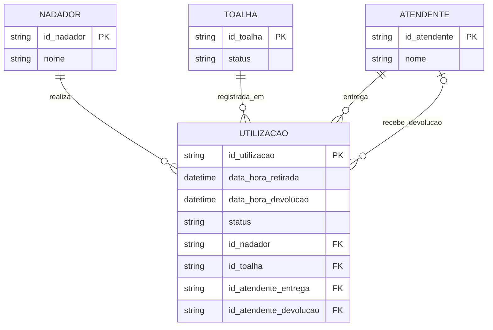

# Sistema Nado Livre — Controle de Toalhas

## Equipe
- Henzo Nunes Dias Soares
- Ryann Richard Soares Silva

## Estudo de caso
A escola de natação Nado Livre oferece empréstimo de toalhas aos alunos ao final dos treinos de natação. Anteriormente, o controle manual das toalhas gerava perda delas e desorganização.

Para solucionar esse problema, o sistema automatiza o controle dos materiais. Seu objetivo principal é rastrear qual nadador está com cada toalha e identificar os funcionários envolvidos. A operação registra o momento exato da retirada, vinculando o nadador, a toalha e o atendente que realizou a entrega. Posteriormente, registra a devolução, que pode ser recebida por um atendente diferente. O sistema deve impedir empréstimos simultâneos duplicados da mesma toalha e manter um histórico completo para a administração.

## Modelo lógico relacional — Diagrama Entidade-Relacionamento (DER)
O diagrama representa as entidades, seus atributos, as chaves primárias (PK), as chaves estrangeiras (FK) e as cardinalidades dos relacionamentos.

## Banco de dados
- **SGBD:** MySQL
- **Nome do banco:** `nado_livre`
- **Quantidade de tabelas:** 4
- **Tabelas:** `nadador`, `toalha`, `atendente` e `utilizacao`
- **Quantidade total de registros de teste:** 1.000

### Descrição das tabelas
- **`nadador`:** armazena o identificador e o nome de cada nadador.
- **`toalha`:** armazena o identificador e o status de cada toalha.
- **`atendente`:** armazena o identificador e o nome de cada atendente.
- **`utilizacao`:** registra cada retirada e devolução, relacionando nadador, toalha e os atendentes envolvidos.

### Principais relacionamentos
- Um nadador pode possuir várias utilizações registradas; cada utilização pertence a um nadador.
- Uma toalha pode aparecer em várias utilizações ao longo do tempo; cada utilização referencia uma toalha.
- Um atendente pode realizar várias entregas.
- Um atendente pode receber várias devoluções. O atendente da devolução pode ser diferente do atendente da entrega.
- A tabela `utilizacao` utiliza chaves estrangeiras para relacionar essas informações.

### Distribuição da massa de dados
| Tabela | Quantidade de registros |
|---|---:|
| `nadador` | 300 |
| `toalha` | 100 |
| `atendente` | 10 |
| `utilizacao` | 590 |
| **Total** | **1.000** |

Os registros são fictícios e foram preparados para testar diferentes nadadores, toalhas, atendentes e situações de utilização.

## Restrições de integridade
O script SQL define chaves primárias para identificar cada registro e chaves estrangeiras para manter os relacionamentos entre as tabelas. Também utiliza campos obrigatórios (`NOT NULL`), valores padrão (`DEFAULT`) e restrições `CHECK` para limitar os status aceitos e impedir que a data e hora da devolução sejam anteriores à retirada.

Os campos de data e atendente da devolução podem ficar nulos enquanto a utilização estiver ativa. Quando a utilização está marcada como devolvida, esses dados devem estar preenchidos.

A regra de negócio determina que uma mesma toalha não pode ter mais de uma utilização ativa ao mesmo tempo. Essa regra precisa ser garantida pela aplicação ou por uma proteção adicional no banco de dados; chaves estrangeiras, isoladamente, não impedem empréstimos simultâneos duplicados.

## Arquivos do projeto
- **`database.sql`:** cria o banco `nado_livre`, define as quatro tabelas, seus relacionamentos e restrições, e insere a massa de 1.000 registros para testes.
- **`README.md`:** documenta o estudo de caso, o DER, a estrutura do banco de dados e a massa de testes.

## Versionamento
Esta etapa deve ser registrada no mesmo repositório GitHub da atividade anterior, mantendo o histórico do trabalho. Recomenda-se desenvolver em uma branch separada, por exemplo, `banco-de-dados`, e registrar a conclusão em um commit.
