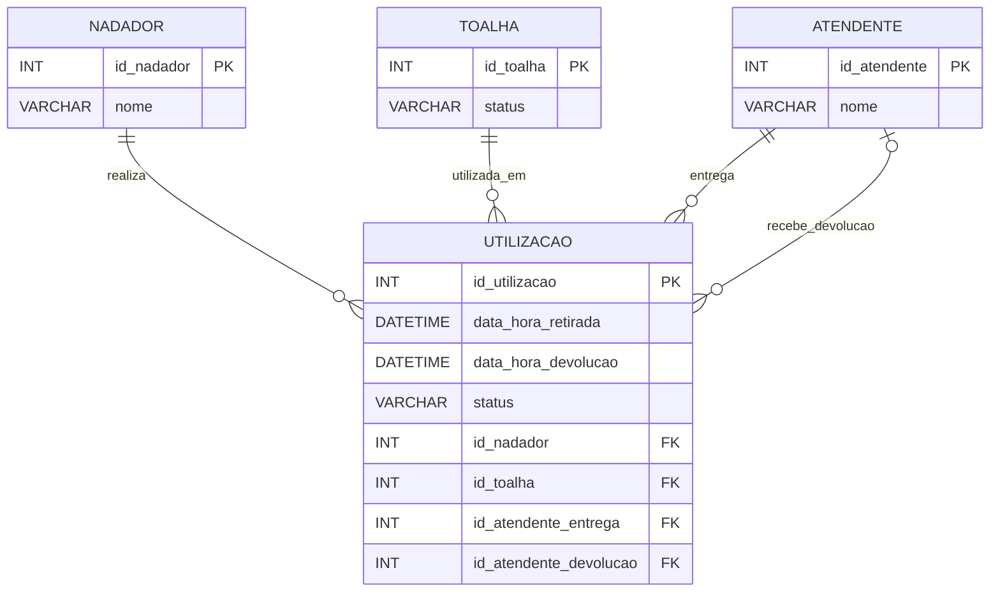

# Sistema Nado Livre — Controle de Toalhas

## Identificação

**Integrantes:**
- Henzo Nunes Dias Soares
- Ryann Richard Soares Silva

**Estudo de caso:** Sistema de controle de empréstimo de toalhas da escola de natação Nado Livre.

## Descrição do sistema

O sistema registra o empréstimo e a devolução de toalhas utilizados pelos nadadores após os treinos. Cada utilização relaciona o nadador, a toalha e o atendente responsável pela entrega. Também registra a data e a hora da retirada e da devolução, permitindo acompanhar a disponibilidade das toalhas e consultar as operações realizadas.

## Diagrama Entidade-Relacionamento (DER)



## Banco de dados

- **SGBD:** MySQL 8.0.16 ou superior.
- **Nome do banco de dados:** `nado_livre`.
- **Quantidade de tabelas:** 4.

**Principais entidades e relacionamentos:**
- `nadador`: armazena os nadadores.
- `toalha`: armazena as toalhas e seus status.
- `atendente`: armazena os atendentes.
- `utilizacao`: registra as retiradas e devoluções, relacionando nadadores, toalhas e atendentes.
- Um nadador pode possuir várias utilizações; cada utilização pertence a um nadador.
- Uma toalha pode aparecer em várias utilizações ao longo do tempo; cada utilização está relacionada a uma toalha.
- Um atendente pode realizar entregas e receber devoluções. O atendente que recebe a devolução pode ser diferente daquele que realizou a entrega.

### Quantidade de registros

| Tabela | Registros |
|---|---:|
| `nadador` | 300 |
| `toalha` | 100 |
| `atendente` | 10 |
| `utilizacao` | 2.590 |
| **Total** | **3.000** |

## Relatórios propostos

1. **Empréstimos por dia:** apresenta a quantidade de retiradas por dia e diferencia utilizações devolvidas das que continuam em aberto.
2. **Toalhas mais utilizadas:** identifica as toalhas com maior quantidade de utilizações e a quantidade de nadadores atendidos.
3. **Movimentação por atendente:** apresenta a quantidade de entregas e devoluções realizadas por cada atendente.
4. **Empréstimos em aberto:** lista as utilizações que ainda não possuem devolução registrada.

As consultas SQL correspondentes estão no arquivo [`relatorios.pdf`](relatorios.pdf).

## Funcionalidades previstas para a versão final em POO

- Cadastrar, listar, consultar e atualizar nadadores, toalhas e atendentes.
- Registrar a retirada de toalhas e a devolução dos materiais.
- Consultar utilizações em aberto e históricos de empréstimos.
- Pesquisar informações por nadador, toalha, atendente, período e status.
- Apresentar os relatórios definidos para o sistema.

## Arquivos do repositório

- `README.md`: documentação do projeto.
- `database.sql`: script para criar o banco de dados, as tabelas, os relacionamentos e inserir os registros de teste.
- `relatorios.pdf`: relatório da atividade, com análise do modelo, DER, quantidade de registros, relatórios e planejamento da versão final em POO.

## Como executar o script SQL

1. Abra o MySQL Workbench ou outro cliente compatível com MySQL 8.0.16 ou superior.
2. Abra o arquivo `database.sql`.
3. Execute o script para criar o banco `nado_livre`, suas tabelas e inserir os registros.
4. Ao terminar, confira a quantidade de registros de cada tabela com a consulta:

```sql
USE nado_livre;

SELECT 'nadador' AS tabela, COUNT(*) AS quantidade FROM nadador
UNION ALL
SELECT 'toalha', COUNT(*) FROM toalha
UNION ALL
SELECT 'atendente', COUNT(*) FROM atendente
UNION ALL
SELECT 'utilizacao', COUNT(*) FROM utilizacao;
```

## Uso de Inteligência Artificial

Foi utilizada Inteligência Artificial como apoio à geração de dados fictícios para ampliação da massa de teste e à elaboração das consultas e da documentação. Os dados gerados foram verificados quanto à quantidade de registros, aos identificadores, aos relacionamentos e à coerência das datas e dos status.

## Relatório em PDF

[**Abrir relatorios.pdf**](relatorios.pdf)
